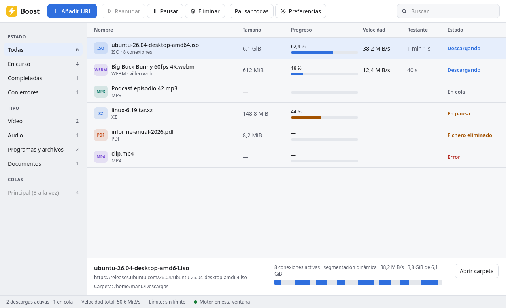
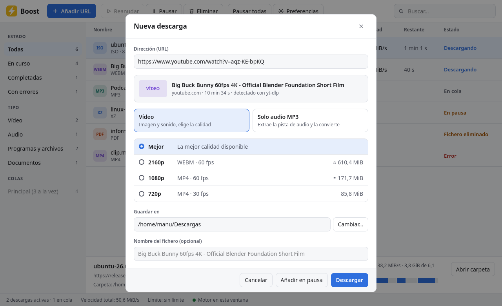
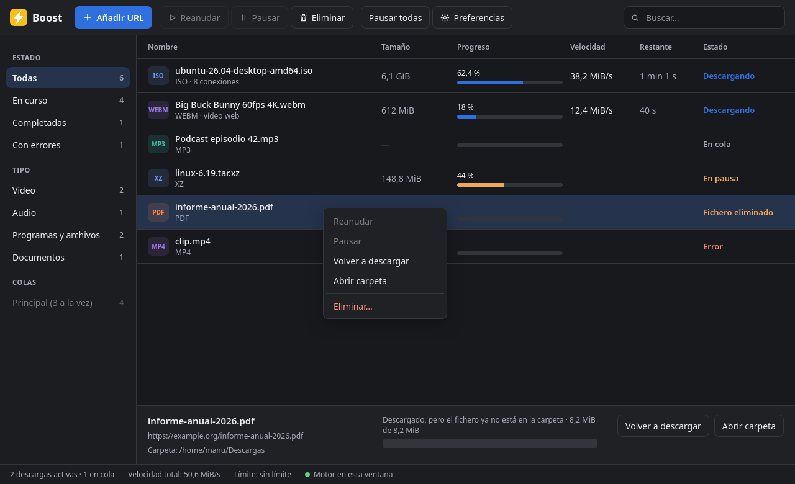
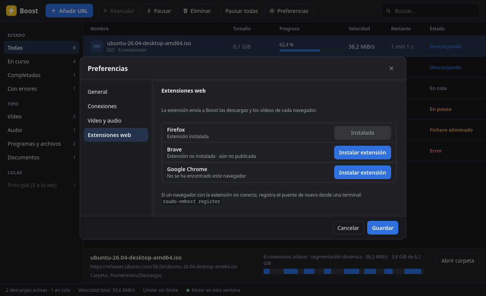

<p align="center">
  
</p>

<h1 align="center">Boost</h1>

<p align="center">
  Gestor de descargas para Linux y Windows: descargas con varias conexiones, vídeos de
  YouTube y cientos de webs, audio MP3 y una extensión que captura las descargas del navegador.
</p>

<p align="center">
  <a href="https://github.com/gallegomanuel8/Boost/releases/latest"><b>Descargar</b></a> ·
  <a href="#instalación">Instalación</a> ·
  <a href="#extensión-del-navegador">Extensión</a> ·
  <a href="#compilar-desde-el-código">Compilar</a>
</p>



## Qué hace

- **Descargas segmentadas.** Cada fichero se baja con varias conexiones a la vez. Cuando una
  conexión termina, la parte más lenta que queda se divide en dos (segmentación dinámica).
  Todas escriben en un único fichero, sin trozos que unir al final.
- **Pausar y reanudar**, también tras cerrar la aplicación o reiniciar el equipo. Las
  descargas a medias se guardan aparte y solo aparecen en tu carpeta cuando terminan.
- **Vídeo de páginas web** con [yt-dlp] (YouTube y cientos de webs): eliges calidad o te
  quedas con la mejor. Las listas **HLS** (`.m3u8`) se descargan con el motor propio,
  segmento a segmento, también las cifradas con AES-128.
- **Solo audio en MP3**, con la calidad que elijas (128–320 kbps o VBR).
- **Extensión para Firefox y navegadores Chromium** (Chrome, Brave, Edge, Vivaldi):
  detecta los vídeos y ficheros de la página, captura las descargas del navegador y
  muestra el progreso de las descargas en curso.
- **Cola de descargas** con número de descargas simultáneas y **límite de velocidad**.
- **Nunca sobrescribe**: si el fichero ya existe, guarda `nombre (1).ext`.
- Avisa cuando un fichero descargado **ya no está en la carpeta** y permite volver a
  descargarlo.
- Selección múltiple, menú contextual, búsqueda, categorías por estado y tipo, tema claro
  y oscuro según el sistema, icono en la bandeja.

<table>
  <tr>
    <td></td>
    <td></td>
  </tr>
  <tr>
    <td align="center">Nueva descarga: calidad de vídeo o solo audio</td>
    <td align="center">Tema oscuro, menú contextual y «Volver a descargar»</td>
  </tr>
</table>

## Instalación

Descarga el paquete de tu sistema desde la
[última versión](https://github.com/gallegomanuel8/Boost/releases/latest).
Ninguno necesita permisos de administrador: Boost se instala solo para tu usuario.

### Linux

```bash
tar xzf boost-*-linux-x86_64.tar.gz
cd boost-*-linux-x86_64
./install.sh
```

Instala `boost` en `~/.local/bin`, lo añade al menú de aplicaciones y registra el puente
con los navegadores que encuentre, incluidos Brave, Chrome, Chromium, Edge y Vivaldi en
Flatpak. Para desinstalar: `./install.sh --uninstall`.

Necesitas las bibliotecas de WebKitGTK y de la bandeja del sistema:

| Distribución | Paquetes |
|---|---|
| Fedora | `sudo dnf install webkit2gtk4.1 libayatana-appindicator-gtk3` |
| Debian / Ubuntu | `sudo apt install libwebkit2gtk-4.1-0 libayatana-appindicator3-1` |
| Arch | `sudo pacman -S webkit2gtk-4.1 libayatana-appindicator` |

Los binarios necesitan glibc 2.39 o posterior (Fedora 40, Ubuntu 24.04, Debian 13 o más
recientes). En distribuciones más antiguas, [compílalo desde el código](#compilar-desde-el-código).

### Windows 10 y 11

1. Descarga `boost-*-windows-x86_64-setup.exe`.
2. Ábrelo y sigue el asistente. Si Windows SmartScreen avisa de que la aplicación no es
   conocida, pulsa **Más información → Ejecutar de todas formas** (el instalador no está
   firmado).

Boost queda en `%LOCALAPPDATA%\Programs\Boost`, con acceso directo en el menú Inicio (y en
el escritorio, si lo eliges), y se registra en los navegadores. Usa WebView2, que ya viene
con Windows 10 y 11. Para desinstalar: *Configuración → Aplicaciones → Aplicaciones
instaladas → Boost → Desinstalar*. El historial de descargas (`%APPDATA%\raudo`) se conserva.

<details>
<summary>Sin instalador: paquete .zip</summary>

1. Descomprime `boost-*-windows-x86_64.zip`.
2. Clic derecho en `install.ps1` → **Ejecutar con PowerShell**, o desde una terminal:
   ```powershell
   powershell -ExecutionPolicy Bypass -File install.ps1
   ```

Para desinstalar: `install.ps1 -Uninstall`.
</details>

### Vídeo y MP3: yt-dlp y ffmpeg

Las descargas normales y las listas HLS no necesitan nada más. Para los vídeos de webs
como YouTube y para convertir a MP3, Boost usa estos programas si están instalados (en el
`PATH`, o en la misma carpeta que Boost):

- [yt-dlp] — obligatorio para vídeos de páginas web.
- [ffmpeg] — une vídeo y audio y convierte a MP3.
- [Deno] o [Node.js] — YouTube los necesita para ofrecer todas las calidades.

| Sistema | Instalación |
|---|---|
| Fedora | `sudo dnf install yt-dlp ffmpeg-free nodejs` |
| Debian / Ubuntu | `sudo apt install yt-dlp ffmpeg nodejs` (o yt-dlp desde [su web][yt-dlp], más actual) |
| Windows | `winget install yt-dlp.yt-dlp Gyan.FFmpeg DenoLand.Deno` |

## Extensión del navegador

La extensión envía a Boost las descargas y los vídeos que detecta en cada página.

- **Firefox:** en Boost, *Preferencias → Extensiones web → Instalar extensión*. También
  puedes abrir con Firefox el fichero `boost.xpi` del paquete.
- **Chrome, Brave, Edge, Vivaldi:** abre `chrome://extensions`, activa el *Modo de
  desarrollador*, pulsa *Cargar descomprimida* y elige la carpeta de la extensión:
  - Linux: `~/.local/share/boost/extension` (en navegadores Flatpak, la carpeta que indica
    el instalador, dentro de `~/.var/app/…`).
  - Windows: `%LOCALAPPDATA%\Programs\Boost\extension`.



Boost solo funciona mientras está abierto: al salir desde la bandeja se pausan y guardan
las descargas. Si la extensión detecta que Boost está cerrado, su ventana muestra el botón
**Lanzar aplicación**, que lo abre en segundo plano.

Aún no son compatibles los navegadores instalados como Snap ni Firefox en Flatpak.

## Uso

- **Añadir URL** (o `Ctrl+N`): pega un enlace. Si es un fichero se descarga directamente.
  Si es una página, Boost la analiza y ofrece vídeo (con calidades) o solo audio MP3.
- **Selección múltiple:** `Ctrl+clic`, `Mayús+clic` o `Ctrl+A`. Reanudar, pausar y
  eliminar actúan sobre todas las seleccionadas. Clic derecho para el menú contextual.
- **Cerrar la ventana** deja Boost en la bandeja y las descargas siguen. **Salir** (menú
  de la bandeja) las pausa y cierra Boost.
- **Preferencias:** inicio con el sistema, descargas simultáneas, límite de velocidad y
  calidad MP3 por defecto.

También hay una herramienta de línea de órdenes, `raudo-cli`, para añadir y controlar
descargas desde la terminal mientras Boost está abierto (`raudo-cli --help`).

## Compilar desde el código

Requisitos: [Rust] estable y, en Linux, las cabeceras de WebKitGTK
(`webkit2gtk4.1-devel` en Fedora, `libwebkit2gtk-4.1-dev` en Debian/Ubuntu).

```bash
git clone https://github.com/gallegomanuel8/Boost.git
cd Boost
scripts/install.sh          # compila e instala para tu usuario
```

Otros scripts:

- `scripts/package.sh` — genera los paquetes de una versión en `dist/` (Linux y, con
  `mingw64-gcc` y el target `x86_64-pc-windows-gnu`, también Windows).
- `scripts/package-windows.ps1` — en Windows, compila y genera el instalador
  `dist\boost-<versión>-windows-x86_64-setup.exe`. Necesita Rust, un compilador MinGW
  (por ejemplo `winget install BrechtSanders.WinLibs.POSIX.UCRT`) e
  [Inno Setup 6](https://jrsoftware.org/isinfo.php) (`winget install JRSoftware.InnoSetup`):
  ```powershell
  powershell -ExecutionPolicy Bypass -File scripts\package-windows.ps1
  ```
- `scripts/sign-extension.sh` — firma la extensión de Firefox en addons.mozilla.org
  (necesita claves de la API de AMO).

### Cómo está hecho

| Componente | Qué es |
|---|---|
| `crates/raudo-app` | La aplicación (Tauri 2): ventana, bandeja y el servicio de descargas dentro. |
| `crates/raudo-service` | Cola, persistencia en SQLite, yt-dlp/ffmpeg y la API para los clientes. |
| `crates/raudo-core` | Motor HTTP segmentado y descargador HLS. |
| `crates/raudo-ipc` | Comunicación local: socket Unix (Linux) o *named pipe* (Windows), con token. |
| `crates/raudo-nmhost` | Puente *Native Messaging* entre la extensión y Boost; `register` lo instala en los navegadores. |
| `crates/raudo-cli` | Cliente de línea de órdenes. |
| `crates/raudo-daemon` | El servicio sin ventana, para usos sin escritorio. |
| `extension/` | Extensión WebExtension (Manifest V3) para Firefox y Chromium. |

«raudo» es el nombre interno del proyecto y se mantiene en los componentes y rutas
internas.

## Licencia

Boost es software libre bajo la [GNU General Public License v3.0 o posterior](LICENSE).

[yt-dlp]: https://github.com/yt-dlp/yt-dlp
[ffmpeg]: https://ffmpeg.org
[Deno]: https://deno.com
[Node.js]: https://nodejs.org
[Rust]: https://rustup.rs
